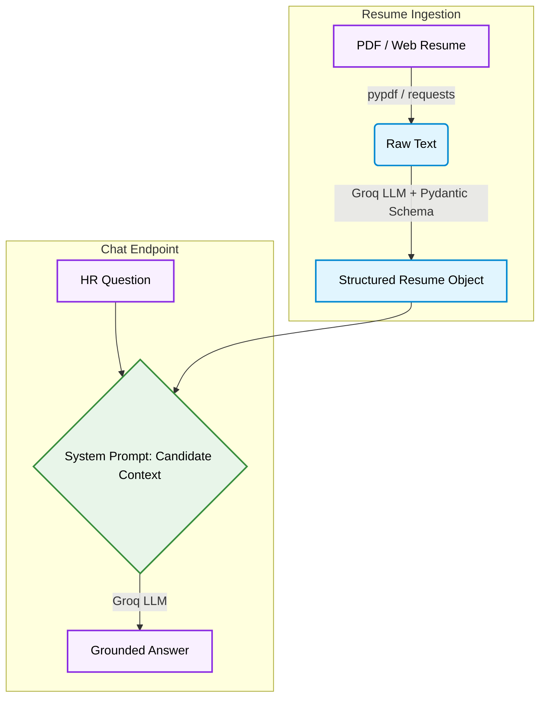

# Hire Me AI

A FastAPI backend that parses a PDF resume into structured data and lets recruiters chat with an AI that represents the candidate, grounded strictly in the parsed resume.

> **Live Deployments:**
> * **Interactive API & Chat UI:** [hiremeai-dn64.onrender.com](https://hiremeai-dn64.onrender.com/)

---

## Overview

Hire Me AI turns candidate resumes into an interactive conversational interface for technical recruiters. Instead of manually skimming multi-page documents, hiring teams can ask natural-language questions and receive answers strictly grounded in the candidate's verified skills, experience, and projects.

```
HR: "What frameworks has this candidate worked with?"
AI: "Based on the resume, the candidate has worked with FastAPI, Streamlit,
     and Flask across their internship and project experience."
```

Every response is anchored to the parsed resume, preventing hallucinations and keeping answers verifiable.

---

## Architecture Overview



---

## Features

| Feature | Description |
| ------- | ----------- |
| **PDF + URL Support** | Extracts raw text from local PDFs or public URLs |
| **Schema-Driven Parsing** | Resume is parsed into a fixed Pydantic schema regardless of section headings or formatting |
| **Candidate AI** | The LLM answers as the candidate - professional, fact-bound, and grounded |
| **Live Portfolio Context** | Downloads and caches context directly from the live portfolio website |
| **Groq-Powered** | Fast structured-JSON inference via Groq models |

---

## Technology Stack

| Component | Technology |
| --------- | ---------- |
| API Framework | FastAPI |
| LLM Inference | Groq |
| Schema Validation | Pydantic |
| Document Extraction | pypdf, python-docx |
| Package & Environment Management | uv |
| Testing | pytest |

---

## Project Structure

```
Hire-Me-AI/
├── backend/
│   ├── main.py          # FastAPI app - resume parsing and /chat endpoint
│   └── my_resume.pdf    # Local candidate resume file
├── tests/
│   ├── conftest.py      # Test configuration
│   └── test_backend.py  # Unit tests for text extraction and chat validation
├── Dockerfile           # Container build specification
├── pyproject.toml       # Project metadata and dependencies
└── README.md
```

---

## Setup and Installation

### Prerequisites

- Python 3.11+
- A [Groq API key](https://console.groq.com/keys)
- [`uv`](https://docs.astral.sh/uv/) installed

### 1. Clone the repository

```bash
git clone https://github.com/Shashank17singh/Hire-Me-AI.git
cd Hire-Me-AI
```

### 2. Install dependencies

```bash
uv sync
```

### 3. Configure environment variables

```bash
cp .env.example .env
# Edit .env and supply your credentials:
# GROQ_API_KEY=your_api_key_here
```

### 4. Provide resume file

Drop your PDF resume into `backend/` or set the `RESUME_URL` / `RESUME_GDRIVE_ID` environment variables.

### 5. Start the server

```bash
uv run uvicorn backend.main:app --reload
```

---

## API Reference

### `GET /`

Serves the interactive chat UI.

### `POST /chat`

Ask a question about the candidate.

**Request body**

```json
{ "question": "What is this candidate's strongest technical skill?" }
```

**Response**

```json
{
  "answer": "Based on the resume, the candidate's strongest technical skill is..."
}
```

---

## Running the Tests

Execute the unit test suite:

```bash
uv run pytest
```

---

## Deployment

The service is packaged as a containerized web application:

```bash
docker build -t hire-me-ai .
docker run -p 8000:8000 -e GROQ_API_KEY=your_key hire-me-ai
```

Live deployment is hosted on Render at [hiremeai-dn64.onrender.com](https://hiremeai-dn64.onrender.com/).

---

## Known Limitations

- The server caches the parsed resume in memory. Supporting multi-user concurrency with different resumes requires session-based cache partitioning.
- Scanned or image-only PDFs without an OCR layer will yield empty text extraction; text-based PDFs are required.

---

## License

This project is licensed under the MIT License. See [LICENSE](LICENSE) for details.
